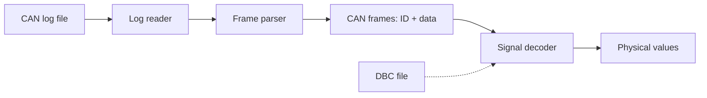

# can-reader-simulator

A small C++ simulator of an **ECU** (Electronic Control Unit) that receives raw frames from a **CAN bus** and translates them into human-readable information.

Instead of staring at hex bytes like `0x1A0 | 03 E8 00 00 ...`, the goal is to get values such as *"engine speed: 1000 rpm"*. The project is software-only: no CAN hardware is needed, frames are read from a log file.

> **Status: work in progress.** Log reading and frame parsing are implemented. Signal decoding with DBC files is the next step (see [Roadmap](#roadmap)).

## Why this project

CAN is the backbone of in-vehicle communication. A raw CAN frame is just an ID and up to 8 data bytes (64 bytes with CAN FD): the meaning of those bytes (which bits form a signal, scaling, offset, unit) is defined separately, usually in a **DBC** file. This project explores that whole path, from raw bytes to physical values, with a clean and extensible C++ architecture.

## How it works



| Stage | Description | Status |
|---|---|---|
| Log reader | Reads the CAN log file line by line | Done |
| Frame parser | Turns each log line into a CAN frame (ID, length, data bytes) | Done |
| Signal decoder | Extracts signals from the data bytes using a DBC definition (start bit, length, byte order, factor, offset) | Planned |
| Output | Prints decoded, human-readable values | Planned |

## Project structure

```
can-reader-simulator/
├── architecture/   # Architecture and design documents
├── code/           # C++ source code
└── .vscode/        # Editor configuration
```

## Getting started

### Requirements

- A C++ compiler with C++17 support (GCC, Clang or MSVC) <!-- adjust to the standard you actually use -->
- <!-- CMake / Make / other build tool, if used -->

### Build

```bash
git clone https://github.com/francescomadaro03/can-reader-simulator.git
cd can-reader-simulator
# TODO: add the real build commands, for example:
# cmake -S code -B build && cmake --build build
```

### Run

```bash
# TODO: add the real command, for example:
# ./build/can-reader-simulator path/to/log_file
```

### Input format

<!-- TODO: describe the supported log format and add one or two example lines. -->
<!-- Example: -->
<!-- (0.000000) can0 1A0#03E8000000000000 -->

## Example output

<!-- TODO: paste real output from your program here. -->

## Roadmap

- [x] Read the CAN log file
- [x] Parse log lines into CAN frames
- [ ] Load signal definitions from a DBC file
- [ ] Decode signals into physical values (byte order, scaling factor, offset)
- [ ] Unit tests
- [ ] Simulate ECU behaviour on top of the decoded data

## Author

Francesco Maria Madaro, Computer Engineering student (Politecnico di Torino), exchange student at KIT Karlsruhe.
[GitHub](https://github.com/francescomadaro03)

## License

<!-- TODO: add a license (for example MIT) and a LICENSE file. -->
